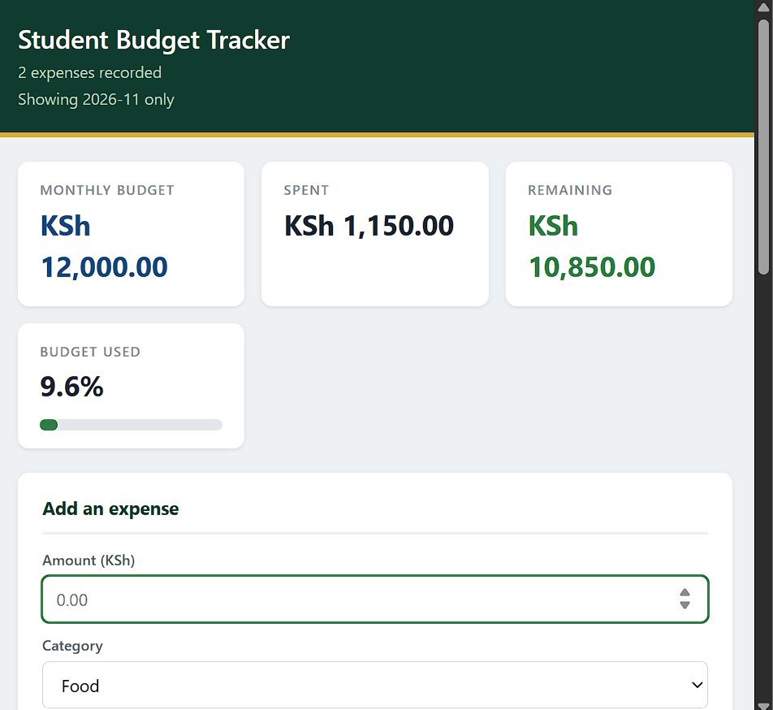

# Student Budget Tracker

A small web app for tracking monthly expenses on a student budget, built with Python and Flask.
Shows what you have spent this month, what is left, and where the money went.

## What it does

- Add expenses with an amount, category, date and optional note
- Set a monthly budget and see how much of it is gone
- Automatically filters to the current month, so old months do not distort the totals
- Breaks spending down by category in a pie chart
- Delete expenses you entered by mistake

## Running it

Then open http://127.0.0.1:5000

## How it is put together

Three Python files, each with one job:

- **budget.py** — all the logic: reading and writing the data, adding and deleting
  expenses, totalling by category, filtering to the current month. Knows nothing
  about the web.
- **chart.py** — builds the pie chart as raw SVG by hand. No charting library:
  each slice angle is amount / total * 360 degrees, and the arc coordinates come
  from sin and cos.
- **app.py** — the Flask layer. Maps URLs to functions, reads form submissions,
  and hands the results to the template.

Data lives in `data.json`, which the app creates on first run. No database.

## Notes

Written while learning Python. The parts I found most interesting were working out
the SVG arc maths for the pie chart, and realising that filtering the expense list
in one place inside `summary()` made every number on the page update at once.
